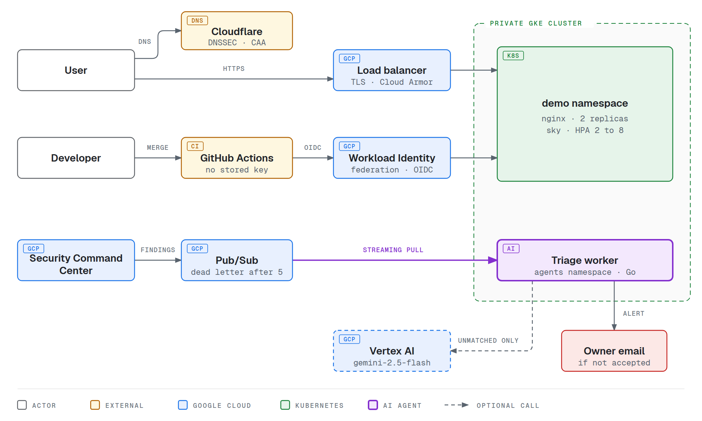
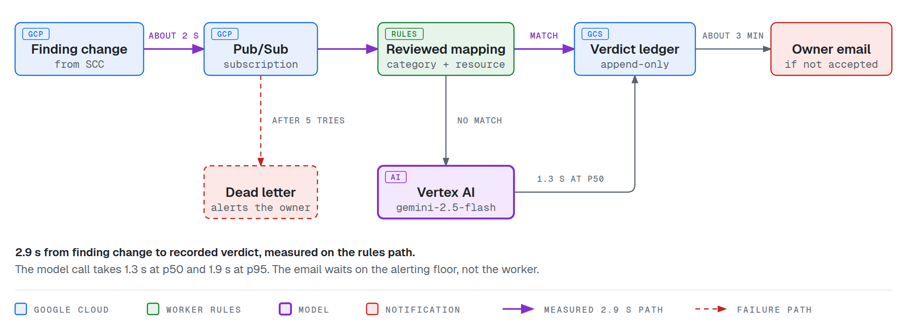
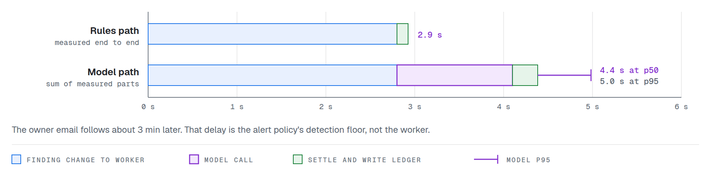
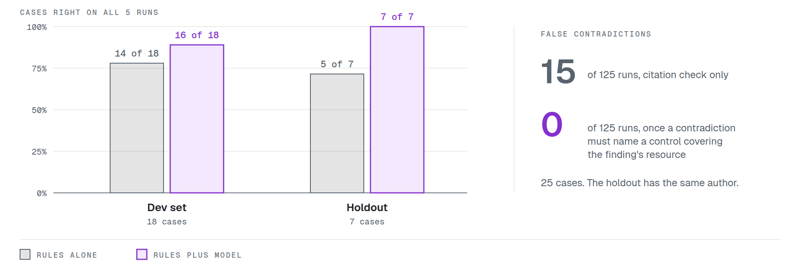
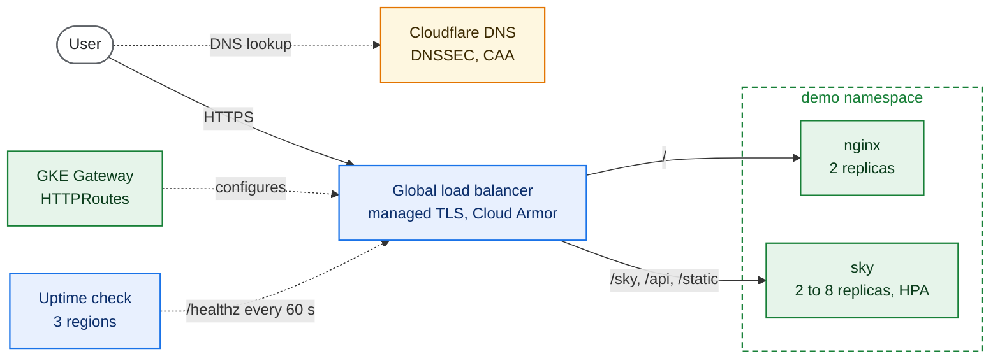
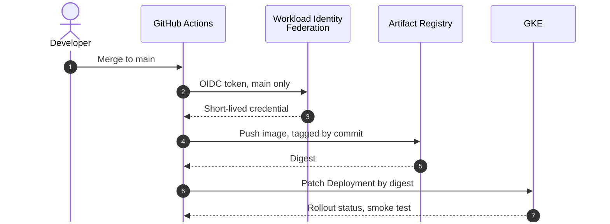

# Secure Kubernetes Platform on GKE, with an AI Triage Agent

A private GKE cluster, keyless delivery, and an AI agent that turns each misconfiguration, threat and exposure finding into a recorded verdict in seconds. Terraform builds it and GitHub Actions deploys to it with no stored key.

> [!NOTE]
> **Closed on 2026-09-22. Shut down on 2026-09-25.** The infrastructure and the `sindrg.com` DNS records are deleted. The code is kept as it ran. See [the shutdown worklog](worklog/shutdown.md).

## At a glance

| Layer | Built with |
| --- | --- |
| Infrastructure | Terraform, GKE Standard with private nodes, custom VPC, Cloud NAT, Dataplane V2 |
| Edge | GKE Gateway, global load balancer, managed TLS, Cloud Armor, Cloudflare DNS |
| Delivery | GitHub Actions, Workload Identity Federation, Artifact Registry, deploys by digest |
| Workload security | Pod Security `restricted`, default-deny NetworkPolicies, Checkov, kube-linter, Dependabot |
| AI agent | Security Command Center, Pub/Sub, Vertex AI `gemini-2.5-flash`, a Go worker |
| Evidence | Cloud Monitoring, k6 load tests, failure drills, worklogs with the command behind each number |

| Merge to Ready | Peak load, no failures | Finding to verdict | False contradictions | Threat model |
| --- | --- | --- | --- | --- |
| **59 s** | **125 rps** on 8 replicas | **2.9 s** | **0** of 125 runs | **11 of 12** closed |

Sources are in [Measured](#measured) and the [threat model](reference/threat-model.md).

## Start here

| Time | Read |
| --- | --- |
| 2 min | This page, down to [the AI triage agent](#ai-triage-agent) |
| 15 min | [The triage worker](reference/triage-worker.md), then the [model scope](decisions.md#model-scope) and [triage idempotency](decisions.md#triage-idempotency) decisions |
| Platform | [Networking](reference/networking.md), [IAM and federation](reference/iam-and-federation.md), [threat model](reference/threat-model.md) |
| Proof | [The worklogs](worklog/README.md), with the commands and their output |
| Failures | [Troubleshooting](troubleshooting.md#symptoms), indexed by symptom |

## Architecture

<picture>
  <source media="(prefers-color-scheme: dark)" srcset="images/diagrams/overview-dark.png">
  
</picture>

Terraform builds everything in Google Cloud: a custom VPC, private nodes across three zones, Cloud NAT, and a control plane reachable only by DNS. [Serving and delivery](#platform) are drawn in more detail below.

## AI triage agent

Security Command Center publishes each finding change to Pub/Sub. A worker in the `agents` namespace counts vulnerability findings and does not triage them, because a vulnerability is fixed by an image pin, not by a decision. It settles every other finding with a reviewed mapping first, and asks Vertex AI only when no mapping matches and the finding is complete. It writes every verdict to an append-only ledger before it notifies anyone.

<picture>
  <source media="(prefers-color-scheme: dark)" srcset="images/diagrams/triage-dark.png">
  
</picture>

### Speed

<picture>
  <source media="(prefers-color-scheme: dark)" srcset="images/diagrams/speed-dark.png">
  
</picture>

A finding change became a recorded verdict in 2.9 s, measured end to end on the rules path in [slice 8](worklog/phase-15-scc-triage.md#recovery). Getting the finding to the worker is most of it. The model path was not timed end to end. It is that measured path plus the model call, 1.3 s at p50 and 1.9 s at p95 from [slice 13](worklog/phase-15-scc-triage.md#latency-and-cost), plus the 285 ms a notifying verdict took to write in [slice 7](worklog/phase-15-scc-triage.md#kill-after-inference-before-persistence).

### Results

<picture>
  <source media="(prefers-color-scheme: dark)" srcset="images/diagrams/accuracy-dark.png">
  
</picture>

The model beats the rules alone only after a contradiction has to land on a control that covers the finding's resource. The evaluation is 25 cases, and one person wrote the holdout. See [slice 14](worklog/phase-15-scc-triage.md#slice-14-a-contradiction-has-to-land-on-something).

### Guardrails

| The model | Enforced by |
| --- | --- |
| Cannot accept a finding | `accepted` is absent from the schema, refused by the worker, and rejected by the validator |
| Cannot act | No tools are declared, and a tool call in the reply is rejected |
| Cannot overspend | 1.00 USD a UTC day. Each call reserves its worst case in the ledger first, so the ceiling survives restarts |
| Cannot lose a finding to a crash | Record, then notify, then acknowledge. A crash at each boundary was [drilled](worklog/phase-15-scc-triage.md#slice-7-the-crash-boundaries-drilled). A message that fails five deliveries is parked on the dead letter topic with its body intact, and an alert fires |
| Was not steered by an injected instruction | An instruction in the fields a resource's creator controls gave [the same verdict](worklog/phase-15-scc-triage.md#the-injection) as without it. The detector-written fields are covered by unit tests only |

The worker holds no Security Command Center permission and no cluster credential. Its code lives in [ai-k8s](https://github.com/sindredg/ai-k8s). How it works is in [the triage worker reference](reference/triage-worker.md).

## Platform

### Serving

The Gateway programs a global load balancer that sends traffic straight to Pod IPs through network endpoint groups.

### Delivery

No key is stored anywhere. In `demo`, the pipeline can patch Deployments and run a smoke-test Pod, and can create nothing else. See [operations](reference/operations.md#what-each-path-applies).

## What it does

### Platform

| Area | What exists | Why | Evidence |
| --- | --- | --- | --- |
| Foundation | Custom VPC, private nodes, Cloud NAT, DNS-only control plane, Dataplane V2, zonal GKE Standard | [Networking](decisions.md#networking), [Cluster](decisions.md#cluster) | [Phase 1](worklog/phase-01-infrastructure.md) |
| Workloads | `nginx` and `sky` in `demo`, with probes, limits and ClusterIP Services | [Configuration](decisions.md#infrastructure-and-configuration) | [Phase 2](worklog/phase-02-nginx-workload.md) |
| Ingress | GKE Gateway, managed TLS, HTTP to HTTPS redirect, path routing | [Ingress and TLS](decisions.md#ingress-and-tls) | [Phase 7](worklog/phase-07-gateway-tls.md) |
| Observability | Uptime check, dashboard as code, alerts for availability, findings and dead letters | [Observability](decisions.md#observability) | [Phase 8](worklog/phase-08-observability.md) |
| Resilience | Node floor of two, disruption budgets, maintenance window, two failure drills | [Cluster](decisions.md#cluster) | [Phase 9](worklog/phase-09-resilience.md), [Phase 10](worklog/phase-10-failure-drills.md) |
| Load | k6 harness, clean rollouts, HPA on `sky`, nodes across three zones | [Load and scaling](decisions.md#load-and-scaling) | [12a](worklog/phase-12a-load-baseline.md), [12b](worklog/phase-12b-rollout-baseline.md), [12c](worklog/phase-12c-rollouts-connections.md), [12d](worklog/phase-12d-autoscaling.md) |

### Delivery

| Area | What exists | Why | Evidence |
| --- | --- | --- | --- |
| CI | Credential-free pull request checks, required on `main` | [Delivery](decisions.md#delivery) | [Phase 3](worklog/phase-03-ci.md) |
| Images | Private registry, immutable tags, non-root images pulled by digest | [Supply chain](decisions.md#images-and-supply-chain) | [Phase 5](worklog/phase-05-custom-image.md) |
| Delivery | Keyless deploys scoped to `main`, namespaced pipeline RBAC, gated rollout | [Delivery](decisions.md#delivery) | [Phase 6](worklog/phase-06-keyless-delivery.md) |
| Upstream pins | A scheduled workflow proposes each pin bump, and the merge is the review | [Pin automation](decisions.md#upstream-pin-automation) | [Notes](worklog/notes/upstream-pin-automation.md) |

### Security and the agent

| Area | What exists | Why | Evidence |
| --- | --- | --- | --- |
| Guardrails | Pod Security `restricted`, namespace quota, default-deny NetworkPolicies | [Workload security](decisions.md#workload-security) | [Phase 4](worklog/phase-04-workload-guardrails.md) |
| Hardening | Default network removed, vulnerability scanning, Log Analytics | [Workload security](decisions.md#workload-security) | [Phase 11](worklog/phase-11-hardening.md) |
| Security baseline | [Threat model](reference/threat-model.md) with 12 findings: 11 closed, 1 accepted | [Workload security](decisions.md#workload-security) | [Phase 13](worklog/phase-13-security-baseline.md), [Phase 14](worklog/phase-14-close-the-baseline.md) |
| Finding triage | Findings over Pub/Sub, settled by reviewed mapping then by model, in an append-only ledger | [Agents](decisions.md#agents) | [Phase 15](worklog/phase-15-scc-triage.md) |
| Patching | Dependabot moves each base image, and a scanner counts what remains | [Residual vulnerabilities](decisions.md#residual-image-vulnerabilities) | [Phase 15b](plan.md#phase-15b-patch-the-images-this-repository-builds) |

Phases 16 to 19 are optional and were not built. [The plan](plan.md#status) says what would justify each.

## Measured

| Area | Metric | Result |
| --- | --- | --- |
| Delivery | Merge to Ready workload | 59 s |
| Delivery | Deploy duration, median of 12 runs | 70.5 s |
| Observability | Alert detection floor | About 3 min |
| Cost | Running cost | kr461.81 a week, covered by credits |
| Load | `sky` saturation, 2 replicas | 40 rps, p95 230 ms |
| Load | `sky` saturation, 8 replicas | 125 rps, p95 394 ms, no failures |
| Load | HPA decision to a Pod on a new node | 97 s |
| Rollouts | Failed requests at 20 rps, before `preStop` | 1.14% |
| Rollouts | Connection failures after `preStop` | 0 of 3 rollouts, from 72 |
| Rollouts | Closed-connection 503s after keep-alive | 0 of 7,150, from 6 |
| Triage | Finding change to message on the subscription | About 2 s |
| Triage | Finding change to recorded verdict, rules path | 2.9 s |
| Triage | Model call p50 and p95, and cost | 1.3 s and 1.9 s, about 0.003 USD |
| Triage | Crash to redelivery, then four ledger states written | About 25 s, then 285 ms |
| Triage | Right on all 5 runs, rules plus model | 16 of 18 dev, 7 of 7 holdout |
| Triage | Right on all 5 runs, rules alone | 14 of 18 dev, 5 of 7 holdout |
| Triage | False contradictions from the model | 0 of 125 runs, from 15 |
| Images | CRITICAL and HIGH vulnerabilities | `frontend` 0, from 17. `sky` 6 with no fix, from 22 |

The command behind each number is in [the worklogs](worklog/README.md).

## Known limitations

| Limitation | Reason |
| --- | --- |
| Terraform state is local | One operator, no automated apply. See the [decision gate](plan.md#later-decision-gates) |
| Bootstrap order not rehearsed on an empty project | Reconstructed from the worklogs in [operations](reference/operations.md#bootstrap-order) |
| Zonal control plane | Cost. The node pool spans three zones |
| `agents` egress admits any host on 443 | NetworkPolicy cannot match hostnames. See [boundary 3](reference/threat-model.md#boundary-3-pod-to-cluster) |
| Six HIGH vulnerabilities in `sky` | No fixed package. [Accepted](decisions.md#residual-image-vulnerabilities) |
| Evaluation is 25 cases, and one person wrote the holdout | A check against tuning, not an independent sample. See [slice 13](worklog/phase-15-scc-triage.md#limitations) |
| Event Threat Detection needs Security Command Center Premium | Ran on a trial. Standard drops threat findings |

## Documentation

| Document | Holds |
| --- | --- |
| [plan.md](plan.md) | What was built, phase by phase, and what stayed optional |
| [decisions.md](decisions.md) | Why each choice was made, its cost, and what was rejected |
| [worklog/](worklog/README.md) | The commands and output behind every claim |
| [troubleshooting.md](troubleshooting.md) | Failures worth not repeating |
| [loadtest/](loadtest/README.md) | The k6 harness |
| [Operations](reference/operations.md) | Where values live, bootstrap order, recovery |
| [Networking](reference/networking.md) | How a request reaches a Pod, and what blocks everything else |
| [IAM and federation](reference/iam-and-federation.md) | Who can do what, and how GitHub gets a token |
| [Threat model](reference/threat-model.md) | Trust boundaries and their findings |
| [Triage worker](reference/triage-worker.md) | How a finding becomes a verdict |
| [Kubernetes concepts](reference/kubernetes-concepts.md) | How Kubernetes works, using the objects this cluster runs |
| [kubectl](reference/kubectl-commands.md) | Commands to operate and inspect the platform |
| [Diagram renderer](scripts/render-diagrams.sh) | Renders the README images from their HTML sources in `scripts/diagrams/` |
